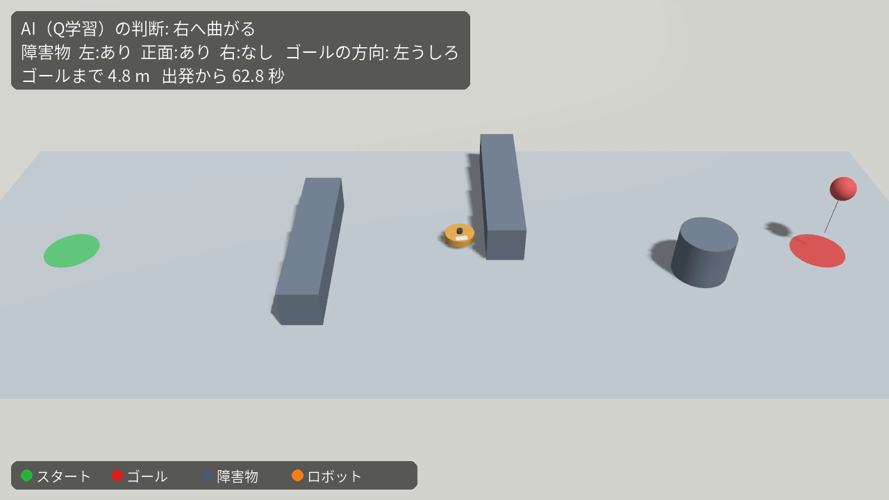
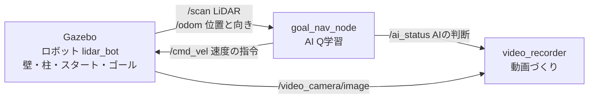
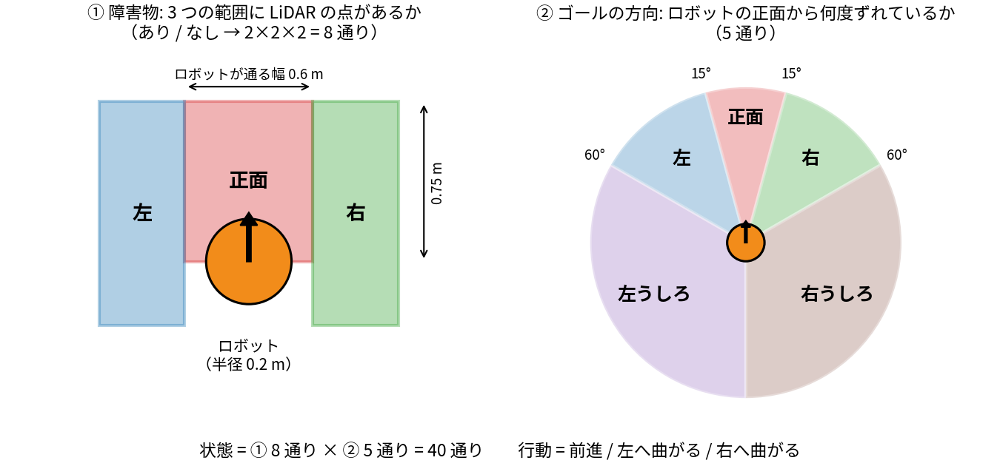
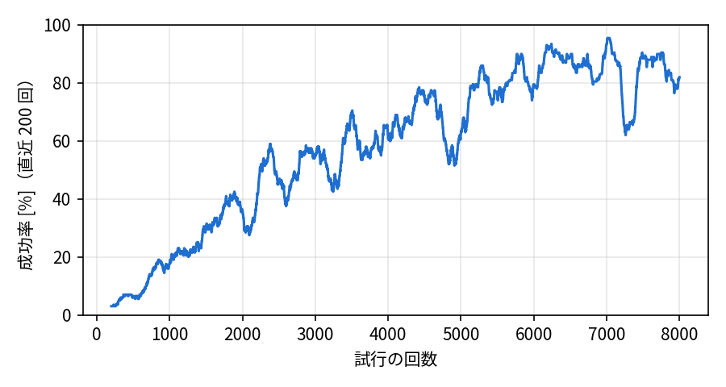
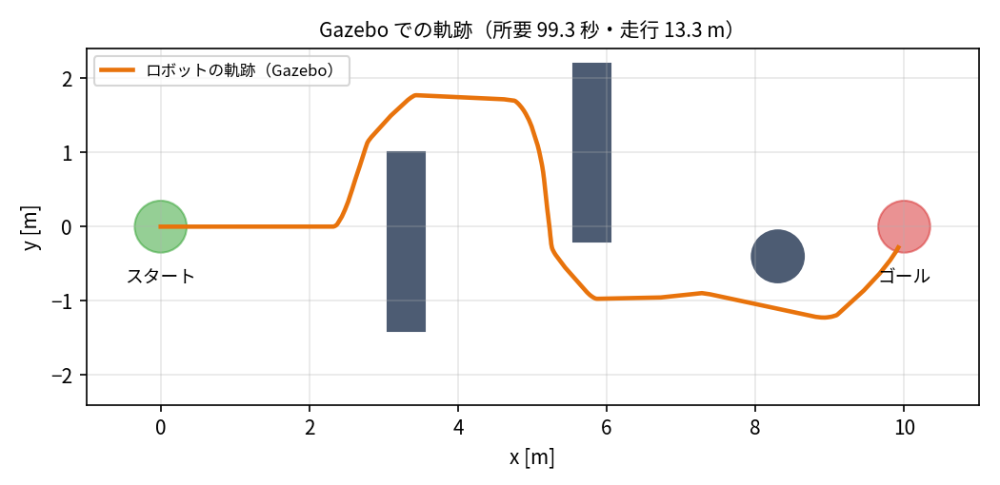

# Q学習で障害物をよけてゴールへ向かうロボット（goal_nav_ws）

Physical AI 応用 最終課題。
ROS 2 + Gazebo の上で、LiDAR を載せた 2 輪ロボットに「スタートからゴールまで移動する」というタスクを与えます。
スタートとゴールの間には障害物（壁 2 枚と柱 1 本）があります。ロボットは、**Q 学習（強化学習）で学んだ AI** が選んだ行動で進み、障害物をよけてゴールに着きます。

- デモ動画（YouTube）: https://youtu.be/yJhHXUEVy2I（1 分 47 秒・等倍速）
- 使用ツール: ROS 2 Lyrical / Gazebo（gz-sim 10）/ Python
- AI: Q 学習（強化学習）。2D の簡易シミュレータで学習し、学習した Q テーブルを ROS 2 のノードで使ってロボットを動かします



## しくみ



ロボットは 0.1 秒ごと（LiDAR のデータが来るたび）に、次の 3 つのことをくり返します。

1. **状態を調べる**: LiDAR で「左・正面・右」の 3 つの範囲に障害物があるか（8 通り）と、ゴールがどの方向にあるか（5 通り）を調べる。合わせて 8 × 5 = **40 通り**の状態のどれかになる
2. **行動を選ぶ**: Q テーブル（40 行 × 3 列の表）の、いまの状態の行を見て、点数が一番高い行動（**前進・左へ曲がる・右へ曲がる** のどれか）を選ぶ
3. **速度を出す**: 選んだ行動の速度を `/cmd_vel` に出す



## AI（Q 学習）の学習

Q テーブルの点数は、2D の簡易シミュレータ（`sim2d.py`）の中で、ロボットに試行錯誤させて決めました（`train.py`）。

| 項目 | 内容 |
|---|---|
| 試行の回数 | 8000 回（毎回、ゴールの位置と障害物の配置をランダムに変える） |
| 報酬 | ゴールへの「いちばん近づいた記録」を更新した分だけ +（1 m で +5）、0.1 秒ごとに −0.02、正面に障害物があるのに前進したら −1、ぶつかったら −20（表面まで 0.25 m 未満。5 cm の余裕を含む）、ゴールに着いたら +20 |
| 学び方 | Q 学習（学習率 0.1、割引率 0.98）。たまに（はじめは 100%、最後は 5%）ランダムな行動を試す（ε-greedy） |
| 学習にかかる時間 | 約 3 分（CPU のみ） |
| 結果 | 学習に使っていない 1000 通りの配置で、**成功 99.7%**（衝突 0.3%、時間切れ 0%） |

乱数の種（0, 1, 2）を変えて 3 回学習し、テストの成功率が一番高かった種 1 の結果を使っています（種 0: 98.6%、種 2: 99.0%）。
学習が進むと成功率が上がっていきます（学習中はわざとランダムな行動も混ぜているので、テストより低めに出ます）。



学習した Q テーブルは [`config/q_table.csv`](src/goal_nav/config/q_table.csv) です（Excel でも開けます）。たとえば次のような行動を覚えました。

| 状態 | 選ぶ行動 |
|---|---|
| 障害物なし・ゴールが正面 | 前進 |
| 障害物なし・ゴールが左 / 右 | 左へ / 右へ曲がる（ゴールの方を向く） |
| 正面に障害物・ゴールが正面 | 右へ曲がる（障害物をよける） |
| 右に障害物・ゴールが右 | 前進（障害物にそって進み、通りすぎてから曲がる） |
| 左と正面に障害物 | 右へ曲がる（空いている方へ） |

## 結果

Gazebo で、スタート (0, 0) からゴール (10, 0) まで走らせた結果です（動画と同じ回）。ロボットは壁 1 を上側から、壁 2 を下側から回り込み、柱の下を通ってゴールに着きました。



| 項目 | Gazebo（動画の回） | 2D 簡易シミュレータ（同じ配置） |
|---|---|---|
| 結果 | ゴールに到着 | ゴールに到着 |
| 出発からゴールまでの時間 | 99.4 秒 | 99.0 秒 |
| 走った距離 | 13.3 m | 13.3 m |
| 障害物との一番小さいすき間（ロボットの表面から） | 9.8 cm | 9.4 cm |
| AI が選んだ行動の回数 | 前進 460・左へ曲がる 274・右へ曲がる 260 | ― |

時間はシミュレーションの時間です。Gazebo の値は rosbag2 に記録した `/odom` から求めました。

## 動かし方

動作確認した環境: Windows 11 + WSL2（Ubuntu 26.04）、ROS 2 Lyrical、Gazebo（gz-sim 10）

```bash
# 1. 必要なものを入れる（ROS 2 Lyrical のリポジトリは設定済みとする）
sudo apt install ros-lyrical-desktop ros-lyrical-ros-gz ros-dev-tools ffmpeg fonts-noto-cjk python3-matplotlib

# 2. ビルド
git clone https://github.com/kenichirotanizakido-sudo/goal_nav_ws.git ~/goal_nav_ws
cd ~/goal_nav_ws
source /opt/ros/lyrical/setup.bash
colcon build
source install/setup.bash

# 3. 実行（Gazebo の画面が開き、3 秒後にロボットが動き出す）
ros2 launch goal_nav goal_nav.launch.py

# 画面なしで実行して、動画を作る（~/goal_nav_video.mp4 ができる）
ros2 launch goal_nav goal_nav.launch.py gui:=false record:=true
```

ゴールの位置は `goal_x:=8.0 goal_y:=1.0` のように変えられます（ワールドの赤い印は動きません）。

### 学習をやり直す

```bash
cd ~/goal_nav_ws/src/goal_nav
python3 -m goal_nav.train   # config/q_table.csv と docs/ の図が新しくなる（約 3 分）
cd ~/goal_nav_ws && colcon build
```

## 参考にしたリポジトリ

[OsawaKousei/2DRoboPrac_ws](https://github.com/OsawaKousei/2DRoboPrac_ws)（Gazebo と ROS 2 で LiDAR ロボットを動かすコード）の `nav_dev` パッケージと、作者による [Qiita の解説記事](https://qiita.com/N622/items/9d89f77d85d9da0af29e) を参考に作りました。

| 2DRoboPrac_ws（nav_dev） | このリポジトリ（goal_nav） | 変えたところ |
|---|---|---|
| `models/LidarRobo/model.sdf` | `models/lidar_bot/model.sdf` | 同じ「2 輪 + キャスター + 360 度 LiDAR」の構成。形は CAD のメッシュではなく円柱で作った |
| `models/worlds/nav_slam.sdf` | `models/worlds/goal_world.sdf` | スタート・ゴール・障害物と、撮影用カメラを置いた |
| `config/nav_slam.yaml` | `config/bridge.yaml` | `ros_ign_bridge` → `ros_gz_bridge`、`ignition.msgs` → `gz.msgs` |
| `launch/nav_spawn.launch.py` | `launch/goal_nav.launch.py` | 同じ流れ（Gazebo 起動 → ロボットをスポーン → ブリッジ）。`ros_ign_gazebo` → `ros_gz_sim` |
| `src/lidar_node.cpp`（C++） | `goal_nav/goal_nav_node.py`（Python） | 同じく `/scan` を見て `/cmd_vel` を出す。行動の決め方を if 文から Q 学習の Q テーブルに変えた |

参考リポジトリは ROS 2 Humble + Ignition Gazebo Fortress 用です。ここでは ROS 2 Lyrical + Gazebo（gz-sim 10）で動くように書き直しています。

## ファイル構成

```
goal_nav_ws/
└── src/goal_nav/
    ├── goal_nav/
    │   ├── q_agent.py          # AI の頭脳: 状態の作り方・行動・Q テーブルの読み書き
    │   ├── sim2d.py            # 学習用の 2D 簡易シミュレータ
    │   ├── train.py            # Q 学習（学習して config/q_table.csv を作る）
    │   ├── goal_nav_node.py    # ROS 2 ノード: Q テーブルを使ってロボットを動かす
    │   └── video_recorder.py   # 動画づくり用のノード（ロボットの制御には関係ない）
    ├── config/
    │   ├── bridge.yaml         # ROS 2 と Gazebo をつなぐ設定
    │   └── q_table.csv         # 学習した Q テーブル
    ├── launch/goal_nav.launch.py
    ├── models/
    │   ├── lidar_bot/model.sdf     # ロボット
    │   └── worlds/goal_world.sdf   # ワールド（スタート・ゴール・障害物）
    └── docs/                   # README 用の図
```

